# Syntra Engineering Remediation & Stabilisation Programme: Overview

**Programme Title:** Syntra Comprehensive Engineering Remediation and Stabilisation Programme  
**Programme Lead:** Principal Compiler Engineer, Systems Architect, Runtime & Security Lead  
**Horizon:** Multi-Phase Phased Engineering Execution (Phases 0 through 11)  
**Date:** 2026-11-24  
**Current Status:** **Phase 1 Reopened & Security Remediation Complete (17/17 Adversarial Tests Verified; 104/104 Workspace Tests Passing)**  

---

## 1. Architectural Mandate & Mission

The objective of this programme is to resolve every confirmed defect, architectural inconsistency, integration failure, security vulnerability, and implementation gap discovered during the comprehensive engineering audit of the Syntra platform.

The programme preserves Syntra's full architectural scope:
- General-purpose systems programming language.
- Independent compiler and intermediate representation.
- Whole-program analysis.
- Autonomous Syntra Intelligence Engine (SIE).
- Deterministic verification and optimization passes.
- Syntra Experimental Compilation Engine (SECE).
- Native Cranelift machine compilation (x86_64, aarch64).
- Syntra Adaptive Runtime (SAR) dynamic governor.
- Syntra Learning System (SLS) offline model pipeline.
- Unified developer CLI toolchain (`syn` / `syntra`).

**No subsystem will be simplified or removed merely to make tests pass.** Every capability will be engineered to technical correctness, memory safety, and production reliability.

---

## 2. Non-Negotiable Engineering Principles

1. **Correctness Over Performance:** No optimisation may compromise language semantics, type safety, memory safety, or deterministic compilation.
2. **Architectural Independence:** Intermediate representations must not depend on Cranelift-specific quirks; SIE and ML predictions must never become correctness authorities; developer policy remains authoritative.
3. **Engineering Discipline:**
   - Zero test weakening or test deletions.
   - Zero stubs or fake placeholders.
   - Zero unrelated refactorings during focused bug remediation.
   - Zero production source code modifications without an approved phase plan and regression tests.

---

## 3. Programme Execution Sequence (Phases 0 – 11)

```mermaid
flowchart LR
    P0[Phase 0: Baseline & Planning] --> P1[Phase 1: Package Integrity]
    P1 --> P2[Phase 2: SECE Sandbox Isolation]
    P2 --> P3[Phase 3: Language Semantics & Await]
    P3 --> P4[Phase 4: Runtime Completeness & GC]
    P4 --> P5[Phase 5: IR Consistency Migration]
    P5 --> P6[Phase 6: Approval Gate Integration]
    P6 --> P7[Phase 7: Interpreter/Native Parity]
    P7 --> P8[Phase 8: Self-Hosting Recovery]
    P8 --> P9[Phase 9: SIE / SLS / SAR Validation]
    P9 --> P10[Phase 10: Toolchain & Stdlib Quality]
    P10 --> P11[Phase 11: Performance & Final Validation]
```

- **Phase 0:** Baseline Preservation & Remediation Planning (**COMPLETE**)
- **Phase 1:** Package Integrity & Supply-Chain Security (FIND-001)
- **Phase 2:** SECE Security & Process Isolation (FIND-002)
- **Phase 3:** Language Semantics & Async/Await Correctness (FIND-005, FIND-006)
- **Phase 4:** Native Runtime & Concurrency Completeness (FIND-003, FIND-004)
- **Phase 5:** Compiler & Intermediate Representation Consistency (FIND-013)
- **Phase 6:** Approval, Policy & Optimisation Integration (FIND-009)
- **Phase 7:** Interpreter/Native Parity & End-to-End Correctness (FIND-007)
- **Phase 8:** Self-Hosting Compiler Recovery (FIND-008)
- **Phase 9:** Intelligence, Learning & Adaptive Runtime Validation
- **Phase 10:** Toolchain, Code Quality & Standard Library (FIND-010, FIND-011, FIND-012)
- **Phase 11:** Performance, Portability & Final Validation

---

## 4. Phase 0 Completion Summary

During Phase 0:
1. **Repository & Work Preserved:** Verified working tree status. Zero production files modified.
2. **Baseline Re-established:** Reproduced 59/59 workspace unit tests (2.60s debug, 1.83s release), DAP protocol test (100%), 552 Clippy warnings, and fixture results.
3. **Findings Confirmed:** All 13 findings independently verified with exact source locations and root cause analysis in [`13-remediation-register.md`](file:///Users/Topman/Documents/Projects/aether/remediation_output/13-remediation-register.md).
4. **Remediation Dependency Map Established:** Detailed in [`01-baseline-and-confirmed-findings.md`](file:///Users/Topman/Documents/Projects/aether/remediation_output/01-baseline-and-confirmed-findings.md).

---

## 5. Transition to Phase 1: Package Integrity & Supply-Chain Security

### Target Finding: FIND-001 (CRITICAL)
- **Core Defect:** In `crates/cli/src/package.rs`, lockfile checksums are generated using a 64-bit DJB2 hash of the package name string (`dep_hash = dep_hash.wrapping_mul(33).wrapping_add(*b as u64)`).
- **Objective:** Eliminate this vulnerability by implementing canonical cryptographic SHA-256 hashing over package file contents and Git commit trees.

### Exact Files Expected to Change in Phase 1:
1. `crates/cli/src/package.rs`:
   - Replace DJB2 hashing in `generate_lock_content` with SHA-256 tree hashing.
   - Implement canonical file traversal (ignoring `.git`, sorting file paths for deterministic hashing).
   - Implement strict checksum verification in `lock_dependencies` and dependency resolution during installation.
   - Reject altered, missing, or unexpected package contents.
2. `crates/cli/Cargo.toml`:
   - Add standard `sha2 = "0.10"` or standard crypto digest dependency if not already present.
3. `Package.lock` and `syntra.lock`:
   - Regenerate with verified cryptographic SHA-256 content digests.
4. `crates/cli/tests/test_package_integrity.rs` (New regression test suite):
   - Regression tests for package tampering detection.

### Tests Planned to Establish Phase 1 Success:
1. **File Modification Tampering Test:** Modifying any byte in a dependency file causes lockfile verification to fail with a clear diagnostic.
2. **File Addition/Deletion Tampering Test:** Adding an untracked file or deleting a file in a resolved package triggers checksum mismatch.
3. **Git Commit Tampering Test:** Pointing a Git dependency to a different commit revision triggers verification rejection.
4. **Deterministic Generation Test:** Generating the lockfile repeatedly produces byte-for-byte identical checksums.
5. **Clean Workspace Test:** All 59 existing unit tests continue to pass with zero regressions.
