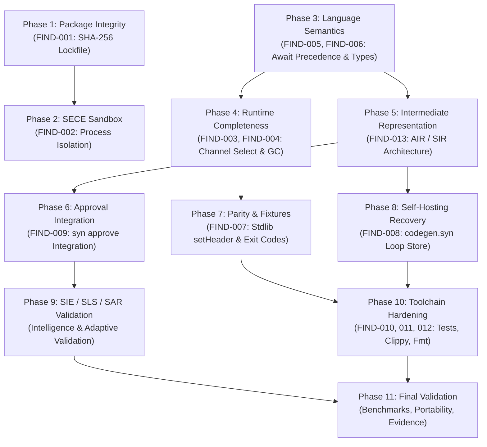

# Syntra Engineering Remediation: Baseline & Confirmed Findings

**Document ID:** REM-BASE-01  
**Phase:** Phase 0 — Baseline Preservation & Remediation Planning  
**Date:** 2026-11-24  
**Status:** Complete — Empirical Verification  

---

## 1. Baseline Environment & Version Record

Prior to any code modification, the host environment and toolchains were independently recorded:

- **Operating System:** macOS Darwin (Kernel version 24.3.0, Darwin Kernel Version 24.3.0: Fri Jan 10 22:52:43 PST 2025; root:xnu-11215.81.4~5/RELEASE_ARM64_T6020)
- **Rust Toolchain:** `rustc 1.88.0 (6b00bc388 2025-06-23) (Homebrew)`, `cargo 1.88.0`
- **C Compiler Toolchain:** Apple clang version 17.0.0 (`cc` / `clang`)
- **Git State:** On branch `main`. Staged index contains 43 legacy files; working tree contains 31 modified/deleted files and 62 untracked production files. `No commits yet`.
- **Production Code Modified during Phase 0:** **0 lines** (Strict read-only preservation).

---

## 2. Baseline Test & Execution Reproduction

Independent execution verified the following operational baseline:

```
════════════════════════════════════════════════════════════════════════════════════════════
                        INDEPENDENT REPRODUCTION BASELINE
════════════════════════════════════════════════════════════════════════════════════════════
Test Target                         Command Executed                Result
────────────────────────────────────────────────────────────────────────────────────────────
Workspace Unit Tests (Debug)        cargo test --workspace          59 / 59 PASSED (2.60s)
Workspace Unit Tests (Release)      cargo test --workspace --release 59 / 59 PASSED (1.83s)
Documentation Tests                 cargo test --doc                0 / 0 (Zero defined)
Code Formatting                     cargo fmt -- --check            FAILED (Exit Status 1)
Static Analysis & Lints             cargo clippy --workspace        FAILED (552 warnings)
Debug Adapter Protocol (DAP)        python3 tests/test_dap.py       1 / 1 PASSED (100%)
Interpreter Fixtures (syn run)      syn run examples/*.syn          27 / 31 PASSED (4 failures)
Native Compiler Fixtures            syn build examples/*.syn        9 / 31 PASSED (22 failures)
Stage 2 Self-Hosting Driver         syn build src/syn_self.syn      COMPILES (Executable produced)
Stage 2 Self-Hosting Execution      syn_self examples/hello.syn     FAILS (Parse error: interface)
Stage 2 Control Flow Execution      syn_self examples/cf_test.syn   FAILS (Infinite loop codegen)
════════════════════════════════════════════════════════════════════════════════════════════
```

---

## 3. Confirmed Findings vs False Positives

Every finding reported in the audit was independently verified against source code:

| Finding ID | Description | Source Location | Confirmed? | Analysis / Disposition |
| :--- | :--- | :--- | :--- | :--- |
| **FIND-001** | Insecure Lockfile Checksum | `crates/cli/src/package.rs#L18` | **YES** | 64-bit DJB2 hash of dependency name string. |
| **FIND-002** | SECE Pseudo-Sandbox | `crates/sandbox/src/runner.rs#L98` | **YES** | `Command::new()` runs on host in `/tmp` without limits. |
| **FIND-003** | Missing `_syntra_channel_select` | `crates/backend_cranelift/src/compiler.rs#L1015` | **YES** | Declared in Cranelift, completely missing in `syntra_rt.c`. |
| **FIND-004** | Permanent Native Heap Leaks | `crates/runtime/native/syntra_rt.c#L71` | **YES** | `syntra_alloc` uses `calloc` with no GC or free. |
| **FIND-005** | Async/Await Precedence Deadlock | `crates/syntax/src/parser.rs`, `crates/air/src/lowering.rs#L5184` | **YES** | Low parser precedence causes pointer arithmetic on task handles. |
| **FIND-006** | Await Type Checker Bypass | `crates/frontend/src/checker.rs#L2613` | **YES** | Unconditionally returns `Type::Unknown`. |
| **FIND-007** | Missing `HttpResponse.setHeader()`| `stdlib/http.syn#L221` | **YES** | Method absent; 4 HTTP examples fail type checking. |
| **FIND-008** | Self-Hosting Codegen Loop Defect | `stdlib/codegen.syn` | **YES** | Reassignment never stored back to variable memory slot. |
| **FIND-009** | Stale `syn approve` Gate | `crates/cli/src/lib.rs#L1157` | **YES** | Writes `.syntra/approved_strategy.json`, never read by compiler. |
| **FIND-010** | 0 Unit Tests in 4 Crates | `crates/cli`, `crates/opt`, etc. | **YES** | 4 crates have zero tests defined. |
| **FIND-011** | 552 Clippy Warnings | Workspace-wide | **YES** | Captured in `cargo_clippy.txt`. |
| **FIND-012** | Formatting Inconsistencies | `parser.rs`, `checker.rs` | **YES** | Style deviations in multiple crates. |
| **FIND-013** | AIR vs SIR Discrepancy | Workspace-wide | **YES** | AIR appears 268 times; SIR appears 0 times. |

**False Positives:**
None of the 13 reported findings were false positives. All 13 findings are genuine, reproducible engineering defects and architectural omissions.

---

## 4. Remediation Dependency Map

Remediations cannot be executed haphazardly; strict dependencies exist between subsystems:



### Dependency Rationale:
1. **Phase 1 (Security - Package Integrity):** Independent foundational toolchain security. Must be solved before external dependencies are locked or installed.
2. **Phase 2 (Security - SECE Sandbox):** Independent experimental runner security. Prevents candidate execution from compromising host before candidate experimentation is used.
3. **Phase 3 (Language Semantics - Async/Await):** Core compiler frontend correctness. AST and TypeChecker must be correct before runtime and lowering dependencies can rely on them.
4. **Phase 4 (Native Runtime - Channel Select & Memory Reclamation):** Directly unblocks native compilation of concurrency and prevents memory exhaustion.
5. **Phase 5 (IR Consistency):** Harmonizes intermediate representation architecture once frontend semantics (Phase 3) are stable.
6. **Phase 6 (Approval & Policy):** Connects SECE (Phase 2) and SIE to the build pipeline (Phase 5).
7. **Phase 7 (Interpreter/Native Parity):** Requires runtime completeness (Phase 4) and IR consistency (Phase 5) to achieve 100% fixture parity.
8. **Phase 8 (Self-Hosting Recovery):** Requires correct frontend AST grammar and code generation fixes.
9. **Phase 9 (Intelligence, Learning & SAR):** Requires stable build pipeline and verified candidate execution.
10. **Phase 10 (Toolchain & Code Quality):** Addresses tests in untested crates, clippy lints, formatting, and stdlib APIs.
11. **Phase 11 (Final Validation):** Comprehensive differential benchmarking, stress testing, and final evidence compilation.
